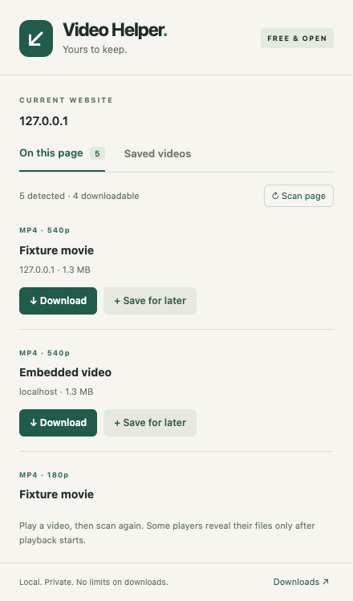

# Video Download Helper

A small, independent, open-source video downloader for Chromium browsers. No account, ads, paywall, watermark, telemetry, server, or runtime dependencies. MIT licensed.

**Independent project:** despite the requested project name, this is not the SAS ACLAP extension from the Chrome Web Store and is not affiliated with it. Use a distinct brand before submitting to an extension store.



## Install

1. Download or clone this repository.
2. In a Chromium browser, open `chrome://extensions` (or its equivalent), enable **Developer mode**, then choose **Load unpacked**.
3. Select the **extension** folder (not the repository root). Pin Video Download Helper in the toolbar.
4. Open a website, play a video, and click Video Download Helper. Use **Scan page** to refresh. Each available file appears separately. Click **Download** to save it to your normal Downloads folder; use **Downloads ↗** to see progress, pause/resume, and errors.

Chrome/Chromium 120+ required. Orca is Chromium based, but its extension installation UI must expose Load unpacked; installation in Orca itself has not yet been verified. No store listing or signed extension is provided.

## What works

- Direct MP4, WebM, Ogg, MOV and M4V files, including signed URLs.
- Video response MIME types, even when URLs lack a file extension.
- Page videos, source elements, media links, performance resources and accessible embedded frames.
- Actual video dimensions when the browser exposes them, and file size when the server supplies it. Different discovered quality files appear separately; the extension does not invent qualities or upscale.
- Per-tab discovery, duplicate removal, toolbar count, and a local saved-video list.
- Native browser downloads: streams directly to disk, without buffering the whole video in extension memory or routing through a third party. Existing filenames are preserved through automatic uniquifying.

## Limits

HLS (`m3u8`) and DASH (`mpd`) manifests are detected and labeled, but not merged/downloaded as videos in v0.1. Blob URLs, DRM, live-stream recording, format conversion, audio extraction, casting, and site-specific extractors are outside this version. Some sites require special authentication/referrer headers, expire URLs, or split audio/video. Downloads may fail there; the browser download page shows the failure. No universal website compatibility or speed advantage is claimed.

Play the video after installing, then scan. Network observation begins when the extension is enabled; it cannot recover past response headers. A tab's results clear on navigation or close. Only discovered links can be downloaded. Lists are capped at 200 entries; saved links can expire. Save for later is a bookmark, not an offline copy.

Download only media you have permission to save. This project is independent of Link64 and SAS ACLAP and contains none of their code or assets.

## Privacy and permissions

See [PRIVACY.md](PRIVACY.md). Host access covers HTTP(S) pages and video CDNs so cross-origin players can be discovered. `webRequest` reads response metadata; it never blocks or changes requests. `activeTab` and `scripting` scan the selected page. `storage` keeps temporary findings and explicitly saved links on your device. `downloads` saves the chosen file. There is no cookie API access, remote code, analytics, or external backend.

## Development and tests

`npm test` runs the dependency-free unit tests. `npm run check` checks JavaScript syntax. `npm run package` creates a verified ZIP in `dist/`; extract the ZIP and load the extracted folder to install a release. GitHub Actions runs unit tests, syntax checks and packaging on pushes and pull requests.

For browser integration tests, install Playwright as a development tool (`npm install --no-save playwright`, then `npx playwright install chromium`). A generated test video requires FFmpeg:

```sh
ffmpeg -f lavfi -i testsrc2=s=960x540:d=5 -an -c:v libx264 -pix_fmt yuv420p /tmp/open-video-fixture.mp4
node tests/browser.mjs
```

The harness starts a disposable browser with the actual extension and a local HTTP fixture server. It checks MIME discovery, frames, dimensions, deduplication, manifests, saved links, exact downloaded bytes, rejected URLs, navigation cleanup, blob handling and HTTP failures. Public pages are smoke checks; unreachable pages are reported as UNVERIFIED. `VIDEO_FIXTURE`, `PLAYWRIGHT_MODULE` and `CHROMIUM_PATH` can point at existing tooling. Test output/screenshots go in ignored `test-results/`.

Contributions: keep runtime dependencies at zero, add a regression check for behavior changes, and document any new permissions. Never commit browsing data, signed media URLs, cookies, or credentials.
