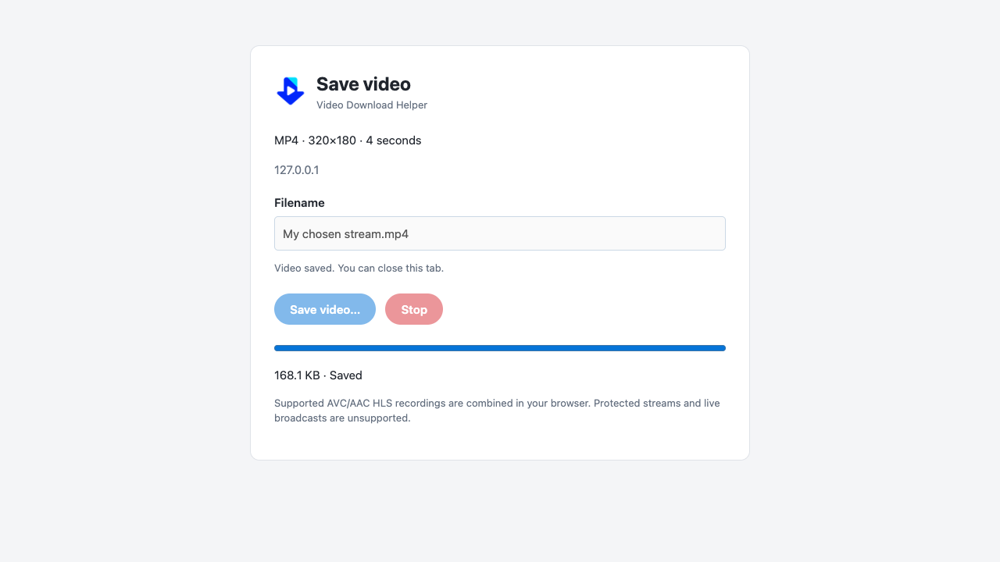

# Video Download Helper

A free, open-source **browser extension**. Direct files and supported HLS recordings save entirely through the browser. No desktop app, installed helper, Python, FFmpeg, native messaging, account, ads or developer cloud service is required to use it.

**Independent project:** this is not the SAS ACLAP store extension and is not affiliated with it.



## Install

1. Download the latest release ZIP and extract it.
2. In a current desktop Chromium browser, open its Extensions page, enable **Developer mode**, then choose **Load unpacked**.
3. Select the extracted folder containing `manifest.json`. Pin Video Download Helper in the toolbar.

From a source checkout, load the `extension/` folder instead. Updating an existing installation: replace its files and click **Reload**. Saved links remain on this device. Legacy helper-only saved format entries require reopening their original page and rescanning; they are not silently downloaded as HTML or deleted. The old optional helper is no longer used or bundled.

Tested in Chrome for Testing on macOS. Other browsers must expose the required extension and File System Access APIs. No store listing, installer or separate desktop edition is provided.

## Download a video

- **Direct files:** open a website, play its video, then open the extension. Choose an available file, edit its name if wanted, and click **Download**. The row shows percentage, bytes, measured speed, estimated time, Pause/Resume and Stop. Stopped/failed transfers offer Retry. Reopening the popup restores current progress.
- **HLS recordings:** play the video and use **Find all qualities** or **Find qualities**. For a supported recording, choose a discovered video/audio pair and click Download. An **extension download tab** opens. Click **Save video…**, choose the destination and keep that tab open until saving completes. Closing the popup does not interrupt it. Stop aborts the file transaction; closing the download tab cancels the job.
- Use Save for a local bookmark, or the × button to dismiss findings until navigation. Saved links can expire and are not offline copies.

The file chooser may ask whether to replace an existing file. Completed writes are committed only after finalization. Cancelling an active write preserves the previous file; a newly selected empty placeholder may remain depending on the browser. Browser downloads lists direct-file transfers; stream files are saved to the location you explicitly chose.

## Supported and limited

- Direct MP4, WebM, Ogg video, MOV/M4V, MKV, AVI, WMV, FLV and 3GP recognition by MIME/suffix, including extensionless video responses and signed URLs. Recognition does not imply browser codec playback support.
- Page videos, source alternatives, links, network response metadata and accessible frames. Actual dimensions are preferred over labels. Unknown data stays unknown.
- Browser HLS: finished **AVC/H.264 video with AAC audio**, muxed TS, separate compatible audio, and fragmented MP4 segments. Encoded packets are copied to MP4 without transcoding. Output is written incrementally to the chosen file, rather than buffering the full video in an extension blob. The library retains reader caches and per-packet indexing metadata; multi-hour/large-file memory behavior has not been exhaustively tested.
- HLS progress can use media position, marked `~`; actual received bytes/rate are reported when available. A final file size is shown only after its writable file closes. Total input bytes/ETA may be unknown; a 100% conversion callback alone is not completion.
- Unsupported in this browser path: encrypted/DRM media (including encrypted Netflix titles), live streams, DASH/MPD, non-AVC/AAC HLS, discontinuities/gaps/variables/I-frame playlists and HTTP redirects. Play/rescan to discover a final URL when redirects are involved. No universal website/quality or faster-than-other-tools claim.
- Bounds: 32 playlists/tracks, nesting depth 4, playlists 2 MiB, segments 64 MiB, reader cache 16 MiB per URL. Explicit public-to-private/local resource references are rejected; browsers do not provide DNS pinning for this code.

Signed-in requests stay inside the browser. The selected manifest origin can receive its normal browser cookies; unrelated origins are requested without credentials. This passed a controlled authenticated-site test, not a guarantee for every login system. No passwords/cookies are exported. Some sites refuse requests or require protected playback even when viewing works.

## Privacy and permissions

See [PRIVACY.md](PRIVACY.md). HTTP(S) host access and `webRequest` discover media across pages/CDNs. `activeTab`/`scripting` scan the selected page. `storage` keeps temporary jobs and explicitly saved links. `downloads` handles direct files. There is no cookies permission, native-messaging permission, remote code or backend server. Save uses the browser's file picker for the specific file you choose.

## Development and verification

Node 22.15+ is used for the tests. Runtime media code is bundled locally; npm dependencies are development tools only.

```sh
npm ci
npx playwright install chromium
npm test
npm run check
```

For media/browser integration tests, install FFmpeg/FFprobe as **test tools**, then run:

```sh
npm run test:hls
npm run test:browser
```

`test:hls` verifies four real HLS outputs using a browser writer, FFprobe and full decoding, plus malformed/encrypted/live inputs, cancellation, URI/credential isolation and resource bounds. `test:browser` loads the actual extension, tests session-cookie requests, quality selection, registered download tabs, saving, cancellation and previous-file preservation. Automated file-selection tests use an OPFS handle; the actual browser Save API also produced a verified playable MP4 on this Mac. See [validation](docs/validation.md) for exact scope and limits.

`npm run package` uses Python only as a build-time ZIP tool. It creates the complete extension archive in `dist/` and verifies required files/notices and absence of a companion installer/native permission. Users do not need Python.

## Open-source components

Our project code is MIT licensed. The unmodified bundled **Mediabunny 1.66.0** component is MPL-2.0; its full license, notices, exact archive hash and corresponding-source link are in [extension/vendor/NOTICE.md](extension/vendor/NOTICE.md). No external media encoder or executable is shipped. [Reference audit](docs/reference-audit.md) and [MDM review](docs/mdm-review.md) describe earlier research; their historical versions are not promises of current runtime support. No proprietary downloader code or GPL project code/assets were copied.

Contributions should keep media credentials out of Git/logs, preserve browser-only operation, add meaningful media/output tests, and document any new permission or unsupported case.
